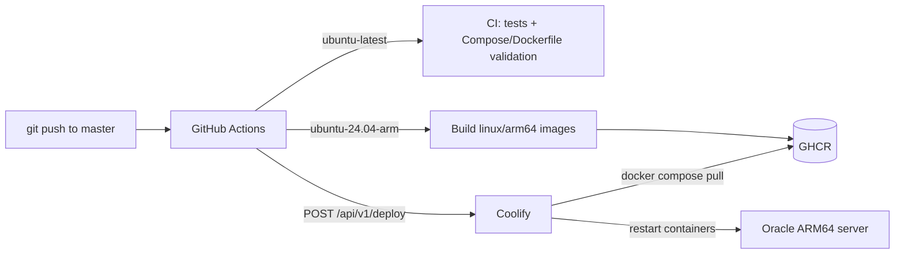

# CI/CD: GitHub Actions → GHCR → Coolify → Oracle Cloud (ARM64)

Production pipeline for the WaruWenJo / HCW@Home monorepo.

The Oracle Cloud server (2 OCPU, 12 GB RAM, aarch64) is already close to its
resource ceiling, so **all compilation and image building happens on
GitHub-hosted runners**. Oracle only pulls finished `linux/arm64` images from
GitHub Container Registry and restarts containers.

---

## 1. Architecture



| Stage | Runs on | What it does |
| --- | --- | --- |
| `CI` (`ci.yml`) | `ubuntu-latest` | Django tests, Angular builds/tests, Compose + Dockerfile validation. Never publishes. |
| `Release` (`release.yml`) | `ubuntu-latest`, `ubuntu-24.04-arm` | Tests, change detection, ARM64 image builds, GHCR push, Coolify deploy, health verification. |
| `Rollback` (`rollback.yml`) | `ubuntu-latest` + registry | Re-points `production` tags at an older published tag, then redeploys. No rebuild. |

### Oracle performs only these operations

- `docker compose pull` of images tagged `production` (or a pinned `sha-…` tag).
- `docker compose up` to create/restart the changed containers.
- `python manage.py migrate` in the `migrate` service, and the idempotent
  `bootstrap_tenant` service.
- `pg_isready` / `redis-cli ping` container health checks.

Oracle never runs `docker build`, `docker buildx`, `npm`, `yarn`, `ng build`,
`pip install`, or a GitHub Actions runner. `docker-compose.production.yml`
contains no `build:` key, and CI fails if one is added.

---

## 2. Repository inventory (what is built, what is preserved)

| Component | Source | Production image |
| --- | --- | --- |
| HCW API (Daphne + Django) | `backend/`, target `api` of `backend/Dockerfile` | `ghcr.io/<owner>/hcw6-backend` |
| HCW Django admin (nginx + statics) | `backend/`, target `admin` of `backend/Dockerfile` | `ghcr.io/<owner>/hcw6-admin` |
| HCW patient frontend | `patient/`, `patient/Dockerfile` | `ghcr.io/<owner>/hcw6-patient` |
| HCW practitioner frontend | `practitioner/`, `practitioner/Dockerfile` | `ghcr.io/<owner>/hcw6-practitioner` |
| WaruWenJo wrapper frontend | `waruwenjo/` (sources incomplete, see §11) | `ghcr.io/<owner>/hcw6-waruwenjo` |
| PostgreSQL 15, Redis 7 | Upstream images | pulled unchanged from Docker Hub |
| Celery worker / beat, migrate, provision | Same `hcw6-backend` image | no separate image |
| LiveKit (video) | **Not** in this repository's Compose files | external, configured per tenant in HCW admin — untouched |

`docker-compose.yml` (local development, still builds) is unchanged.
`docker-compose.production.yml` is the new Coolify manifest.
`docker-compose.waruwnjo.yml` is the separate wrapper stack.

Preserved deliberately: service names (`api`, `admin`, `patient`,
`practitioner`, `celery`, `scheduler`, `migrate`, `provision`, `db`, `redis`),
port mappings (8080 practitioner, 8081 patient, 8082 admin), the
`./data/postgres_data` and `./data/redis_data` bind mounts, `restart: always`,
`db`/`redis` health checks and every environment variable the existing stack
passes.

> One intentional correction: the admin container listens on **8080**
> (`backend/nginx`), while the existing Compose file mapped `8082:8000`. The
> production file maps `8082:8080`. Revert that line if your reverse proxy
> really expects 8000.

---

## 3. Workflows

### `ci.yml` — pull requests and `master`
* `tests` calls the existing `tests.yml`: Django suite against PostgreSQL +
  Redis, and `yarn build` (plus lint/test for patient).
* `deployment-config` runs `scripts/ci/validate-compose.sh`
  (Compose interpolation, "no build directives", GHCR-only images, internal
  ports, preserved mounts, BuildKit Dockerfile checks) and
  `scripts/ci/validate-env.sh` (every interpolated variable is documented in
  this file).
* No registry login, no `packages: write` — pull requests cannot publish.

### `release.yml` — push to `master` (or manual)
1. `validate` calls `ci.yml`; a failing test blocks the release.
2. `detect` maps changed paths to images (`scripts/ci/detect-changes.sh`):
   * `backend/**` → `hcw6-backend` **and** `hcw6-admin`
   * `patient/**` → `hcw6-patient`
   * `practitioner/**` → `hcw6-practitioner`
   * `waruwenjo/**` (excluding `dist/`, `node_modules/`, `.angular/`) → `hcw6-waruwenjo`
   * anything else (docs, root files, workflows) → nothing rebuilt, nothing deployed
   * a push without a usable base commit (`force_all`, new branch) rebuilds everything.
3. `build` runs on `ubuntu-24.04-arm` (native ARM64, no QEMU) with Docker
   Buildx, GitHub Actions layer cache (`type=gha`), OCI labels
   (`revision`, `version`, `source`) and pushes **only** the immutable
   `sha-<40-char-commit>` tag. Every pushed image is then verified to contain
   nothing but `linux/arm64`.
4. `publish` runs only after **all** builds succeeded, and copies each
   `sha-<commit>` manifest onto `production` with
   `docker buildx imagetools create` (no rebuild), then asserts both tags share
   the same digest. A partially published release can therefore never be
   deployed.
5. `deploy-hcw` triggers Coolify and waits for the deployment to finish, then
   probes the configured health URLs. `deploy-waruwenjo` does the same for the
   wrapper in a separate job, so wrapper-only commits never touch HCW.
6. Concurrency group `production-release` (`cancel-in-progress: false`) keeps
   releases serialised.

### `rollback.yml` — manual
Takes an immutable tag and a scope (`hcw`, `waruwenjo`, `both`), verifies the
images exist and are `linux/arm64`, moves `production` back with
`imagetools create`, and optionally redeploys through Coolify.

---

## 4. GHCR configuration

Images are pushed with the workflow's `GITHUB_TOKEN` (`packages: write`), so no
long-lived registry token is needed for publishing.

1. First release creates packages `hcw6-backend`, `hcw6-admin`, `hcw6-patient`,
   `hcw6-practitioner` (and later `hcw6-waruwenjo`) under the repository owner.
2. Package → **Package settings** → *Danger zone*:
   * keep the package **private**, or set it public if you prefer unauthenticated pulls;
   * **Manage Actions access** → the repository must have **Write** access.
3. The Oracle server must be able to pull. Create a GitHub token with
   `read:packages` (classic PAT, or a fine-grained token on the owner with
   "Packages: read"), then follow §6.

`GHCR_OWNER` defaults to `prashanthkumars17` in both Compose files and is passed
explicitly by CI as the lower-cased repository owner. Override it in Coolify if
the packages live under another owner or organisation.

---

## 5. Required GitHub repository secrets and variables

Settings → **Secrets and variables** → **Actions**.

### Secrets

| Name | Purpose |
| --- | --- |
| `COOLIFY_API_TOKEN` | Coolify API token (Keys & Tokens → API tokens), scoped to the team that owns the resources. |
| `COOLIFY_HCW_SERVICE_UUID` | UUID of the Coolify **HCW** Compose application (the `uuid` in its deploy webhook). |
| `COOLIFY_WARUWENJO_SERVICE_UUID` | UUID of the Coolify **WaruWenJo** Compose application. |
| `HCW_HEALTHCHECK_URLS` | One URL per line, optionally `name\|url`: e.g. `api\|https://api.example.org/api/identity/` and `practitioner\|https://app.example.org/`. |
| `WARUWENJO_HEALTHCHECK_URLS` | Same format for the wrapper (e.g. `web\|https://www.example.org/`). |

`GITHUB_TOKEN` is provided by Actions; do not create it.

### Variables

| Name | Purpose |
| --- | --- |
| `COOLIFY_BASE_URL` | Base URL of the Coolify instance, e.g. `https://coolify.example.org` (no trailing slash, no `/api`). |

Health checks: `api` answers `GET /api/identity/`; the admin container answers
`GET /healthcheck`; patient/practitioner answer `GET /`. If a health URL list is
empty, the probe step warns and skips instead of failing.

Never commit a `.env` file, a token, or a webhook URL: everything above lives in
repository settings.

---

## 6. Coolify configuration

Coolify version assumed: **v4** (API `POST /api/v1/deploy?uuid=…&force=true|false`,
`GET /api/v1/deployments/{uuid}`). The workflow was written against that
documented API; confirm the paths on your instance under **Settings → API**.

### 6.1 Registry credentials (private GHCR)

1. **Registries** in the Coolify sidebar (also **Servers → your server → Registries**).
2. Add registry: URL `ghcr.io`, username = GitHub username, password = the
   `read:packages` token. Save and test.
3. Also authenticate the server user once, because Compose runs as that user:

   ```bash
   printf '%s' "$GHCR_READ_TOKEN" | docker login ghcr.io -u <github-username> --password-stdin
   ```

   Run this **on the Oracle server**. It is the only manual command the server
   ever needs; it does not build anything.

### 6.2 HCW resource

Create **+ New → Application → Git repository** with build pack **Docker Compose**:

| Setting | Value |
| --- | --- |
| Repository | this repository, branch `master` (production branch) |
| Build pack | **Docker Compose** |
| Base Directory | `/` |
| Docker Compose Location | `/docker-compose.production.yml` |
| Auto deploy / webhooks | **disabled** (see 6.4) |
| Domains | one per public service (practitioner, patient, admin) — assign them in Coolify as usual |

Environment variables (**Environment Variables** tab), all of them Coolify
secrets, never committed:

| Variable | Required | Meaning |
| --- | --- | --- |
| `DJANGOSECRET_KEY` | yes | Django secret key. The stack refuses to start without it (no insecure `abcd` fallback in production). |
| `POSTGRES_PASSWORD` | yes | Database password; also used by `db` and every backend service. |
| `POSTGRES_DB` | no | Defaults to `hcw`. |
| `POSTGRES_USER` | no | Defaults to `hcw`. |
| `ALLOWED_HOSTS` | no | Comma separated hosts. Defaults to `*` as in the current file; set real hostnames in production. |
| `DEBUG` | no | Defaults to `False`. Set `True` only temporarily for diagnostics. |
| `CSRF_TRUSTED_ORIGINS` | no | Comma separated origins, e.g. the admin domain. |
| `GHCR_OWNER` | no | Defaults to `prashanthkumars17`. |
| `APP_TAG` | no | Defaults to `production`. Pin an immutable `sha-…` tag to freeze the stack. |
| `TENANT_SCHEMA` | no | Defaults to `default`; `bootstrap_tenant` schema. |
| `TENANT_NAME` | no | Tenant display name. |
| `TENANT_PRIMARY_DOMAIN` | no | Practitioner host served by this tenant. |
| `TENANT_PATIENT_DOMAIN` | no | Patient host. |
| `TENANT_ADMIN_DOMAIN` | no | Admin host. |
| `PRACTITIONER_BASE_URL` | no | Public practitioner URL stored on the tenant. |
| `PATIENT_BASE_URL` | no | Public patient URL stored on the tenant. |
| `SUPERUSER_EMAIL` | no | Bootstrap superuser email. |
| `SUPERUSER_PASSWORD` | no | Bootstrap superuser password — set a real one in production. |
| `LIVEKIT_URL` | no | LiveKit server URL; empty leaves LiveKit unconfigured. |
| `LIVEKIT_API_KEY` | no | LiveKit API key. |
| `LIVEKIT_API_SECRET` | no | LiveKit API secret. |
| `MESSAGING_FROM_EMAIL` | no | Sender address for the messaging provider. |
| `SSO_PROVIDER_ID` | no | Defaults to `openid`. |
| `SSO_NAME` | no | Defaults to `Keycloak`. |
| `SSO_CLIENT_ID` | no | Empty disables SSO. |
| `SSO_CLIENT_SECRET` | no | SSO client secret. |
| `SSO_SERVER_URL` | no | SSO issuer URL. |
| `SSO_DISABLE_PASSWORD_LOGIN` | no | Defaults to `false`. |

The `migrate` and `provision` services run on every deployment. `migrate` is
the existing deployment-time migration mechanism; `bootstrap_tenant` is
idempotent by design (`backend/tenants/management/commands/bootstrap_tenant.py`).

Copy the resource UUID from **Webhooks → Deploy Webhook (auth required)** —
that value is `COOLIFY_HCW_SERVICE_UUID`.

### 6.3 WaruWenJo resource

Same procedure with `docker-compose.waruwnjo.yml` and these variables:

| Variable | Required | Meaning |
| --- | --- | --- |
| `GHCR_OWNER` | no | Defaults to `prashanthkumars17`. |
| `WWJ_TAG` | no | Defaults to `production`; pin a `sha-…` tag to freeze. |
| `WWJ_BACKEND_URL` | yes | Base URL the wrapper proxies `/api` and `/ws` to, e.g. `http://<hcw-project>-api-1:8000` on the shared Docker network or `https://api.example.org`. |

Copy its UUID into `COOLIFY_WARUWENJO_SERVICE_UUID`.

### 6.4 Disable Coolify's own Git auto-deploy

**Critical.** If Coolify still deploys on Git push, it would redeploy on every
push *before* GitHub Actions published the image, and would ignore the release
gate. In the resource's **Webhooks** screen, disable/delete the automatic
deployment webhook (or turn off "Auto deploy"), and keep only the deploy
webhook used by Actions. Deployments then come exclusively from `release.yml`
and `rollback.yml`.

### 6.5 Verify no source build remains

* The Compose file has no `build:` key — Coolify's deployment log shows
  `docker compose ... pull` / `up`, never `Building`.
* `docker-compose.production.yml` has `pull_policy: always`, so a redeploy
  always fetches the current `production` tag rather than reusing a cache.

---

## 7. Triggering a deployment

* **Normal release**: merge/push to `master`. A release with no image-affecting
  change builds and deploys nothing.
* **Force a full rebuild**: Actions → *Release* → *Run workflow* →
  `force_all = true`.
* **Publish without deploying**: `skip_deploy = true`.
* Each run's summary shows commit SHA, image tag, image list, the Coolify
  deployment UUID and the trigger outcome.

Manual Coolify deploy (same endpoint the workflow uses):

```bash
curl -X POST "$COOLIFY_BASE_URL/api/v1/deploy?uuid=$COOLIFY_HCW_SERVICE_UUID&force=false" \
  -H "Authorization: Bearer $COOLIFY_API_TOKEN"
```

---

## 8. Rollback

1. Pick the target commit from **Actions → Release** run history (the tag is
   `sha-<commit sha>`) or from the package listing in GHCR.
2. **Actions → Rollback → Run workflow**: `image_tag = sha-<commit sha>`,
   `scope = hcw | waruwenjo | both`, `deploy = true`.
3. The workflow verifies the images still exist and are `linux/arm64`, copies
   their manifests back onto `production`, and redeploys through Coolify.

Nothing is rebuilt and no source is needed, so rollback is fast and the Oracle
server still only pulls.

**Database caveat:** migrations are *not* rolled back. An older application
image is only safe against a migrated database when the migration was
backwards compatible (additive). If a release contained a destructive
migration, restore the database from a backup instead — the `./data/postgres_data`
bind mount and its volume are never deleted by these workflows, and no workflow
runs `docker compose down -v`.

Alternative freeze without rollback: set `APP_TAG` (or `WWJ_TAG`) in Coolify to
a `sha-…` tag and deploy.

---

## 9. ARM64 compatibility

* Builds run on `ubuntu-24.04-arm` (native aarch64 GitHub-hosted runner),
  producing `linux/arm64` exclusively — no emulation, no multi-arch index.
* `scripts/ci/verify-arm64.sh` inspects each manifest after the push and fails
  the release unless every platform is `linux/arm64`. The rollback workflow runs
  the same check before touching production tags.
* Base images used by the Dockerfiles all publish `linux/arm64`:
  `python:3.13`, `node:22`, `docker.io/nginxinc/nginx-unprivileged:1.28-bookworm`.
* Python wheels in `backend/requirements.txt` (`cryptography`, `pillow`,
  `grpcio`, `psycopg`, `reportlab`, `PyYAML`, `ujson`) ship `manylinux_2_28_aarch64`
  wheels, and `ffmpeg` is installed from the Debian arm64 archive.
* Node dependencies are pure JS/Angular; no native addon is compiled in the
  frontend images.

Check an image by hand:

```bash
docker buildx imagetools inspect ghcr.io/<owner>/hcw6-backend:production
./scripts/ci/verify-arm64.sh ghcr.io/<owner>/hcw6-backend:production
```

---

## 10. Troubleshooting

| Symptom | Cause / fix |
| --- | --- |
| `Build ... failed` in CI | The failing job is the culprit image; the log ends with the Docker error. Re-run the failed jobs only. |
| `image is not linux/arm64 only` | A build was run without `platforms: linux/arm64`, or a base image lost arm64 support. Fix and re-release. |
| `Coolify deploy request failed with HTTP 401` | `COOLIFY_API_TOKEN` invalid/expired, or belongs to another team than the resource. |
| HTTP 404 on `/api/v1/deploy` | Coolify is older than the Compose API, or `COOLIFY_BASE_URL` points at an instance path. Check Settings → API. |
| Deployment `failed` | The log tail is printed by `coolify-deploy.sh`. Typical causes: missing `DJANGOSECRET_KEY`/`POSTGRES_PASSWORD`, GHCR auth on the server, or an image tag that does not exist. |
| `manifest unknown` on the server | The `production` tag was never promoted (build failed) or `GHCR_OWNER`/`APP_TAG` is wrong. |
| Health probe fails but deployment says finished | The container started but the app is unhealthy; check `docker compose logs api` on the server. |
| Admin UI unreachable on 8082 | Confirm the admin service maps `8082:8080` (nginx listens on 8080). |
| Wrapper release restarts HCW | It must not: they are two Coolify resources with separate UUIDs. Verify `COOLIFY_WARUWENJO_SERVICE_UUID` is not the HCW one. |
| `waruwenjo` skipped with a warning | Expected until the Angular sources are committed (§11). |

---

## 11. WaruWenJo wrapper status

This repository currently contains only `waruwenjo/dist/`, `waruwenjo/.angular/`,
`waruwenjo/node_modules/` and a single spec file — no `package.json`,
`angular.json` or `src/`. The wrapper therefore cannot be compiled yet.

What is already in place:

* `waruwenjo/Dockerfile` (Angular build → nginx-unprivileged, port 8080),
  `waruwenjo/nginx.conf.template`, `waruwenjo/.dockerignore`.
* `docker-compose.waruwnjo.yml`, a separate Coolify resource so wrapper changes
  never restart HCW.
* A `hcw6-waruwenjo` entry in the release pipeline, gated on
  `waruwenjo/package.json` + `waruwenjo/angular.json` existing.

Once the sources are committed, the next `master` push builds and publishes the
image and deploys only the wrapper stack. No workflow edit is required.

---

## 12. Proving Oracle only pulls images

1. **GitHub side**: every entry in the `Release` run is a job on
   `ubuntu-24.04-arm` / `ubuntu-latest`; the run log shows
   `docker/build-push-action` and the pushed `sha-…` tag. Settings → Actions →
   Runners must list **no self-hosted runner** for this repository.
2. **Registry side**: GitHub → your profile/org → Packages lists the images with
   their `sha-…` and `production` tags.
3. **Oracle side**, while a deployment runs:

   ```bash
   docker ps --format '{{.Image}}' | grep ghcr.io     # running released images
   docker images | grep -E 'hcw6-|buildx'             # local images, no build cache growth
   ```

   Coolify's deployment log shows `docker compose ... up --pull always` and
   container recreation only. There is no `#1 [builder]` build output.
4. **CPU/RAM**: `docker stats --no-stream` during a deployment should stay flat;
   `uptime` load average should not spike as it would during a Docker build.
5. **Compose proof**: `grep -n 'build:' docker-compose.production.yml` returns
   nothing, and `./scripts/ci/validate-compose.sh` enforces it on every PR.

---

## 13. Manual setup checklist

GitHub:
- [ ] Enable Actions on the repository.
- [ ] Create secrets `COOLIFY_API_TOKEN`, `COOLIFY_HCW_SERVICE_UUID`,
      `COOLIFY_WARUWENJO_SERVICE_UUID`, `HCW_HEALTHCHECK_URLS`,
      `WARUWENJO_HEALTHCHECK_URLS`.
- [ ] Create variable `COOLIFY_BASE_URL`.
- [ ] Confirm GHCR packages grant the repository **Write** access.
- [ ] No self-hosted runner configured.

Coolify:
- [ ] Add the `ghcr.io` registry credential and `docker login` on the server.
- [ ] Create the HCW application (Docker Compose build pack,
      `/docker-compose.production.yml`), set its secrets, disable auto-deploy.
- [ ] Create the WaruWenJo application (`/docker-compose.waruwnjo.yml`), set its
      secrets, disable auto-deploy.
- [ ] Point Domains at practitioner / patient / admin services.
- [ ] Push to `master` once and watch the `Release` run end-to-end.

---

## 14. Files added by this change

| File | Purpose |
| --- | --- |
| `.github/workflows/ci.yml` | CI entry point: tests + deployment-config validation on PRs. |
| `.github/workflows/tests.yml` | Made reusable (`workflow_call`); test logic unchanged. |
| `.github/workflows/release.yml` | Change detection, ARM64 builds, GHCR push, production tag promotion, Coolify deploy + health verification. |
| `.github/workflows/rollback.yml` | Manual rollback by immutable tag, no rebuild. |
| `docker-compose.production.yml` | Image-only Coolify stack; no `build:`, data mounts and settings preserved. |
| `docker-compose.waruwnjo.yml` | Independent wrapper stack. |
| `waruwenjo/Dockerfile`, `waruwenjo/nginx.conf.template`, `waruwenjo/.dockerignore` | Wrapper image (activates when the Angular sources are committed). |
| `backend/.dockerignore`, `patient/.dockerignore`, `practitioner/.dockerignore` | Smaller build contexts: no `node_modules`, `.venv`, `dist`, `www`, `android`, `ios` in the upload. |
| `scripts/ci/detect-changes.sh` | Path → image matrix. |
| `scripts/ci/validate-compose.sh` | Compose invariants + Dockerfile checks. |
| `scripts/ci/validate-env.sh` | Every interpolated variable is documented here. |
| `scripts/ci/verify-arm64.sh` | `linux/arm64` manifest gate. |
| `scripts/ci/promote-images.sh` | Manifest copy for `production` promotion and rollback. |
| `scripts/ci/coolify-deploy.sh` | Trigger + poll Coolify until the deployment finishes. |
| `scripts/ci/health-check.sh` | Post-deploy HTTP probes. |
| `docs/CICD-COOLIFY-DEPLOYMENT.md` | This guide. |
